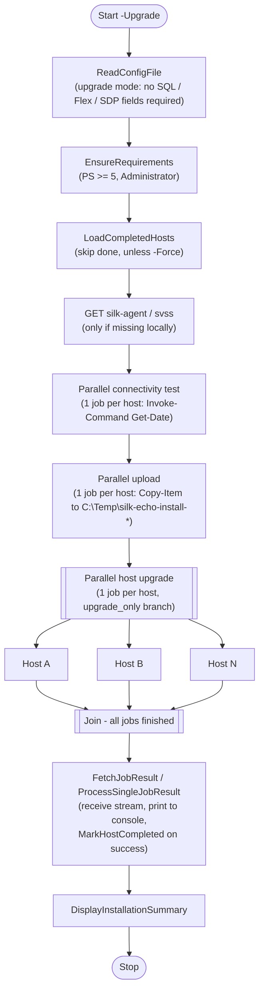
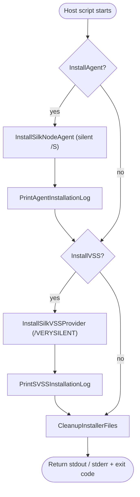
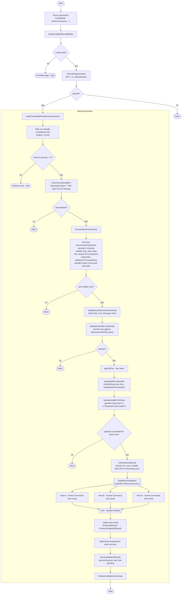
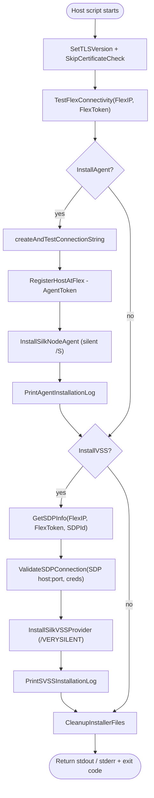

# Silk Echo Installer Internals

How `orchestrator.ps1` (v0.1.14) works: the call flow, and the ports and
services it needs. The orchestrator runs on an administrator workstation
and installs **Silk Node Agent** and **Silk VSS Provider** on N remote
Windows hosts in parallel over PowerShell Remoting.

For step-by-step install instructions, configuration reference, and
troubleshooting, see [readme.md](readme.md). This document covers what the
installer does under the hood and what the network must allow.

---

## 1. Fresh install — generate config for N hosts

Run on the operator workstation:

```powershell
.\orchestrator.ps1 -CreateConfigTemplate
```

The script will interactively ask:

- Use Active Directory (Kerberos) auth for the hosts? (Y/n)
- Install Silk VSS Provider? (Y/n)
- Target installation directory (empty = default paths)

It writes `config.json` next to the script. Edit it and fill the `hosts`
array with N entries. Each entry may be a bare string (IP or AD hostname)
or an object that overrides common fields (e.g. per-host `sql_user` /
`sql_pass`).

For each installer you may set `path` (a local file already on the
workstation) or `url` (download from somewhere other than the default
Google Cloud Storage location). Leave both empty to use the pinned
versions listed in section 3.

Generated shape (simplified):

```json
{
  "installers": {
    "agent": { "url": "", "path": "" },
    "vss":   { "url": "", "path": "" }
  },
  "common": {
    "install_agent": true,
    "install_vss": true,
    "install_to_directory": "",
    "sdp_id": "sdp_id",
    "sdp_user": "sdp_user",
    "sdp_pass": "sdp_pass",
    "sql_user": "sql_user",
    "sql_pass": "sql_pass",
    "sql_server": "host,port",
    "flex_host_ip": "flex-ip",
    "flex_user": "flex_user",
    "flex_pass": "flex_pass",
    "host_user": "host_user",
    "host_pass": "host_pass",
    "host_auth": "credentials",
    "mount_points_directory": "C:\\MountPoints"
  },
  "hosts": [
    { "host_addr": "host_ip", "sql_user": "sql_user_1", "sql_pass": "sql_pass_1" },
    "host_ip",
    "host_ip"
  ]
}
```

When `host_auth = active_directory`, the `host_user` / `host_pass` fields
are dropped and each host entry is a hostname (not an IP — IPs that cannot
be reverse-resolved are rejected).

---

## 2. Run the installer

```powershell
# Live install of all hosts in config.json (default concurrency = 10)
.\orchestrator.ps1 -ConfigPath .\config.json

# Limit parallelism
.\orchestrator.ps1 -ConfigPath .\config.json -MaxConcurrency 5

# Validate connectivity only, no changes
.\orchestrator.ps1 -ConfigPath .\config.json -DryRun

# Ignore processing.json and reprocess everything
.\orchestrator.ps1 -ConfigPath .\config.json -Force

# Save full transcript
.\orchestrator.ps1 -ConfigPath .\config.json -Log C:\Logs\install.log
```

Progress and per-host logs are written under
`SilkEchoInstallerArtifacts\` next to the script. Completed hosts are
tracked in `SilkEchoInstallerArtifacts\processing.json` so reruns skip
them unless `-Force` is used.

---

## 2b. Upgrade an existing installation

Use `-Upgrade` to install newer Agent / VSS Provider binaries on hosts that
are already registered. The installers run silently and keep their current
Flex and SDP credentials, so the upgrade config needs no credentials.

```powershell
# Generate a minimal upgrade config (config-upgrade.json)
.\orchestrator.ps1 -CreateConfigTemplate -Upgrade

# Check connectivity and uploads without changing anything
.\orchestrator.ps1 -ConfigPath .\config-upgrade.json -Upgrade -DryRun

# Run the upgrade
.\orchestrator.ps1 -ConfigPath .\config-upgrade.json -Upgrade
```

Upgrade mode skips Flex registration, SQL credential validation, and the SDP
credential check. It still validates host connectivity and uploads the
installers.



On each host the `upgrade_only` branch runs:



---

## 3. Required technologies, services, and open ports

### Operator workstation (where orchestrator runs)

| Requirement                | Notes                                                      |
| -------------------------- | ---------------------------------------------------------- |
| PowerShell 5+              | Enforced by `EnsureRequirements`                           |
| Administrator privileges   | Enforced by `checkAdminPrivileges`                         |
| Outbound HTTPS (443)       | To `storage.googleapis.com` for installer download         |
| Outbound HTTPS (443)       | To Flex (`flex_host_ip`) and SDP (`mc_https_port`)         |
| Outbound WinRM 5985/5986   | To every target host                                       |
| Domain user (optional)     | Required only when `host_auth = active_directory`          |

### Target Windows hosts

| Service / Port             | Purpose                                                         |
| -------------------------- | --------------------------------------------------------------- |
| WinRM service running      | `Enable-PSRemoting` on each host                                |
| TCP 5985 (HTTP WinRM)      | Default remoting transport                                      |
| TCP 5986 (HTTPS WinRM)     | Alternative remoting transport                                  |
| TCP 445 (SMB / admin$)     | Used for `Copy-Item -ToSession` and AD UNC copy                 |
| SQL Server (TCP 1433 / discovered) | Agent prerequisite; `GetMSSQLHostPorts` enumerates active listeners |
| Outbound HTTPS 443 → Flex  | Agent registration, SDP discovery                               |
| Outbound HTTPS → SDP (`mc_https_port`) | VSS Provider connection                              |
| TrustedHosts entry         | Added automatically by orchestrator when `host_auth = credentials` |

### External services consumed

- **Silk Flex** — REST API (`/flex/api/...`) for login, host registration,
  SDP lookup. Reached at `flex_host_ip` over HTTPS.
- **Silk SDP** — REST API (`https://<mc_floating_ip>:<mc_https_port>/api/v2/...`),
  authenticated with `sdp_user` / `sdp_pass`.
- **SQL Server** — Agent's backing database, validated remotely with the
  supplied SQL credentials.
- **Google Cloud Storage** — Hosts the installer binaries
  `silk-agent-installer-v1.1.17.exe` and `svss-2.0.20.exe` (URLs in
  `orc_component_versions`).

### Components installed on each host

- **Silk Node Agent** — silent installer (`/S`), takes SQL connection
  string, Flex IP, agent token, optional `/D=<install dir>`.
- **Silk VSS Provider** — silent installer (`/VERYSILENT /LOG=...`),
  configured against the discovered SDP.

---

## 4. Fresh-install flow (Mermaid)

Assumes the config is fully filled in and `-DryRun` / `-Upgrade` are NOT
set. Validations are inline; the diagram shows where each one would
abort.



On each remote host, `SetupHost -> setup` runs:



---

## Key validation points (in execution order)

1. **PowerShell version + Administrator** — `EnsureRequirements`.
2. **Config schema** — `ReadConfigFile` / `constructHosts` (requires
   `install_agent` or `install_vss`, valid `host_auth`, IP for
   credentials auth).
3. **Local installer artifacts** — `EnsureLocalInstallers` downloads
   from GCS if not provided locally.
4. **Host reachability** — parallel `Invoke-Command` smoke test.
5. **SQL credentials** — remote test using discovered MSSQL listener
   ports (`GetMSSQLHostPorts`, priority for port 1433).
6. **Flex login + SDP lookup + SDP login** — on the orchestrator side.
7. **Installer upload** — parallel `Copy-Item -ToSession` (or UNC for
   AD auth) into `C:\Temp\silk-echo-install-<timestamp>`.
8. **Per-host setup** — Flex connectivity, host registration, silent
   Agent install, SDP validation, silent VSS install, cleanup.
